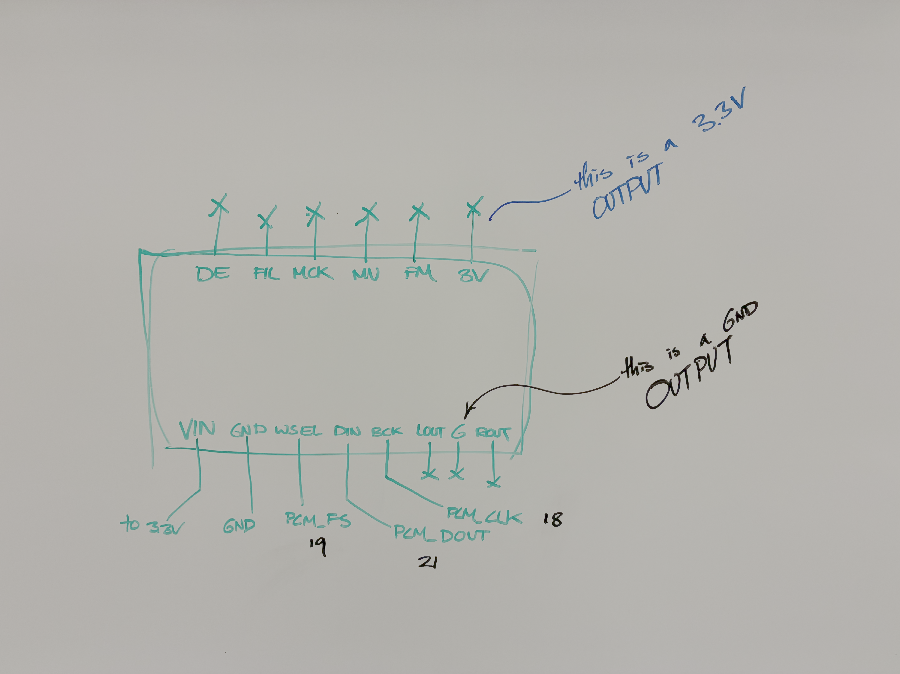
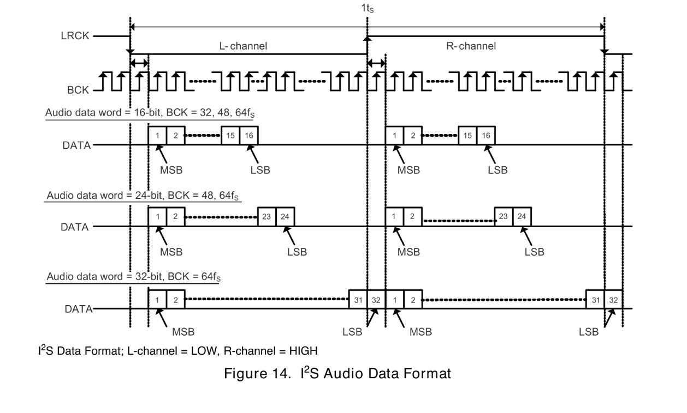
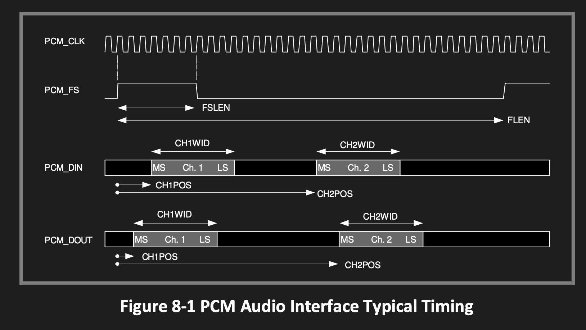
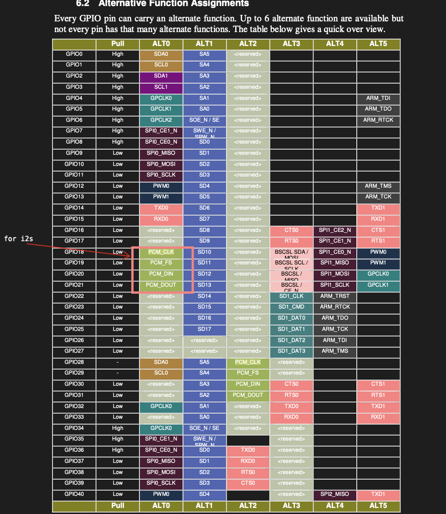

# DAC fun
So you have a DAC and want to make it go bleep bloop. Great, me too! bleep bloop indeed. I love when that happens. To do this you'd need to do a few things. Specifically, we aim to:

1. learn about the PCM5102 DAC
2. learn about the I2S protocol
3. learn about the clock signal generator on your lovely Pis which are _not documented??_
4. have a jolly good time using the I2S hardware on the PI
5. _experience visceral sadness when your copying time creates audible gaps_
6. fix visceral sadness via DMA and ringbuffers
7. feel disappointed due the limited joy that square waves bring you, and thus enable float hardware
8. make a synth?

This lab unfortunately has no starter code because it is in fact officially implemented in Rust; also for a different DAC (don't worry, I tested this one too). If you Daniel mode'd Lab 18 (microphone) in 240LX then great job! you should only have steps 6 and 7 to do.

## DAC Setup
Bleep bloops are airwave thingys hitting your eardrums. You cannot have airwaves using just 0s and 1s, as they have to be expressed in *amplitudes* and not *bits*. To fix this, we are going to use a Digital Audio Converter (DAC). Such a device converts *digital* audio signals in terms of 0 and 1s into *analog* signals which is then amplified by your headphones and it goes bleep bloop.

To figure out how to make your bleep bloop machine bloop, you can boop the boop in the following pictoor thanks to Max Cura:



## i2s intro (DAC Side)
Audio is banged out a block at a time to i2s, often in 32 bits at a time. We are going to use the following format for standardisation and the fact that the DAC has been tested:

```
[0----------31][32----------63]
^channel 1     ^channel 2
```

That is, we will have 64 bits a frame, and 32 bits per channel packed back to back. We would call a "frame" the entire thing above of 64 bits, syncing every 32 bits. Now, there's a tricky bit of figure in PCM5102 which you should know about (page 14, figure 15):



> [!IMPORTANT]
> i2s audio from our DAC is **falling-edge aligned** This means that the MSB of the DATA word for a given frame is ONE `PCM_CLK` (aka `BCK`) to the right of when the `PCM_FS` clock shifted. In other words, we actually switch channels one clock cycle after the `PCM_FS` shifts. This fact will be useful shortly.

## i2s intro (PI Side)
Now, please pull out `BCM2835-ARM-Peripherals` and navigate to pp119. At this juncture you will experience a figure:



What a great picture. What do we see? We see four pins, three of which is relevant for us at the moment.

- `PCM_CLK`: a good ol' clock, this clocks each bit in `PCM_DIN` and `PCM_DOUT`
- `PCM_FS`: "frame sync" a much longer clock, this clocks in the left and right channels, syncs a "frame"
- `PCM_DOUT`: bits to be sent out to the recipient, in this case your DAC
- ~~`PCM_DIN`: utter irrelevance (input, we are not doing this)~~

Each of these *pins* correspond to an actual GPIO pin in your computor. Specifically, these ones in pp102:



> [!IMPORTANT]
> Notice that all the i2s pin stuff are `ALT_FUNCTION_0`. If you are me and smolbrained you will promptly forget this fact. Please don't forget it, or Tianle and Ryker will jointly yell at you at a chipper 11PM time about how you didn't do the one thing that you should have done. 

----------------------------------------------------------------------

## Task 1: i2s Setup
- **Task**: set up an i2s frame using conventions.
- **Goal**: make the BCM bang out i2s frames that agree with what the PCM5102 is looking for.
- **Behavior**: hunt down and set a bunch of registers
- **Document**: BCM2835-ARM-Peripherals, pp125

Let's set up i2S. Every[^1] i2s register is named `something_A`, which implies that there's a `something_B`, except there isn't because Broadcom is a paper products company that happens to write datasheets. I'm therefore going to refer to everything with their proper `*_A` names and this does not mean you should look for a `_B`. 

> [!TIP]
> I would pull out `BCM2835-ARM-Peripherals` and plaster figure `8-1` (page 119) somewhere. On the side, I would pull out PCM5102 data sheet and plaster figure `14` (page 16) somewhere else. These are the two things we want to make agree.

### The "Obvious Things", for transmission
By reading the BCM figure it actually gives us a pretty good idea of some things we need to configure. Combine this to taste with the frame description above to figure what you need to put where.

- `FLEN`: how long is a frame, in `MODE_A`
- `FSLEN`: how long is should frame select (i.e. channel) change sides, in `MODE_A`
- `CH1WID`: width of channel 1, in `TXC_A` <- here lies dragons, see `CH1/2WEX` below
- `CH2WID`: width of channel 2, in `TXC_A` <- here lies dragons, see `CH1/2WEX` below
- `CH1POS`: offset of channel 1, in `TXC_A`
- `CH2POS`: offset of channel 2, in `TXC_A`

> [!TIP]
> Notice FLEN sets the frame length to (FLEN+1) clocks! and **HINT**: `CH1POS` should not be 0, and `CH2POS` should not be 32.

### Clock Inversion
`CLKI` in `MODE_A` has two modes: 0 - outputs change on rising edge; 1 - outputs change on falling edge. Astute examination of Figure 15 in PCM5102 will create the revelation that MSB of the DATA line starts clocking out on the **falling edge**. So you should probably turn `CLKI` on.

Thus we want to set `CLKI=1`

### Frame Sync Inversion
`FSI` in `MODE_A` has again two modes. 0 - normally low, go high; 1 - normally high, go low. Sadly, the Broadcom Paper Company can't make it clear what "normally" means (or maybe I can't read), but again by looking at the PCM5102 figure (which you still have pulled up, right??) indicates that we want to begin the frame low, and go high. Turns out, normally for BCM means "in the second half", as in, "go high means start the frame high." 

Thus we want to set `FSI=1`.

### Width Extension
`CH1WEX` and `CH2WEX` will have to be set as well to enable our frame conventions above. This is because `CH1WID` and `CH2WID` has the following cheeky phrase in it:

> This field has been extended with CHI1WEX bit giving a total width of (CH1WEX*16)+CH1WID+8

The mathematically endowed would thus notice that to get, say, 32 clock frames, we'd have to set `CH1WID=8` and `CHI1WEX=1` and similarly `CH2WID=8` and `CHI2WEX=1`.

### Turning Stuff On
`CH1EN`, `CH2EN` actually turns the channels on in `TXC_A`. You'll probably need to do that if you want things to be on, which sounds good compared to dead silence.

[^1]: this is in fact a lie because of the fact that the clock signal generator is /technically/ one of the registers but isn't here but I'm getting ahead of myself...

----------------------------------------------------------------------

## Task 2: Clocks
- **Task**: set up the sample rate and actual clock for PCM.
- **Goal**: start the GPIO pin clock and make our audio sample rate 48kHz
- **Behavior**: hunt down and set a bunch more registers
- **Document**: mostly not documented? so I guess this one here.

Throughout all of the above joyous joy you will realize that we never actually set two most important things for music: what is our sample rate, and, for that matter, how fast is `PCM_CLK` going to tick anyways? First, this is the time to talk about the two main modes of PCM:

- **master**: you generate how fast your clock is; often in long processing chains we will have one clock that ticks for everyone else multiplexed
- **slave**: someone else tells you how fast your clock is, and you listen; useful if you are a microphone or you are receiving audio

We are going to be **master** today[^2]. This also means we have to generate a clock. However, after some soul searching you may find that there is in fact no registers to configure a clock. With additional desperation you may find that this in fact does not exist and is not documented. But some [kind soul](https://firmanhp.com/assets/20241005-id-raspi-bare-metal-rust/pdf/BCM2837-ARM-Peripherals-Revised-V2-1.pdf) annotated their copy of the BCM Peripherals doc with the clock generation information on the internet, and so, we in fact do have the data sheet which we can make available here. And so, here comes the Data Sheet:

### The Datasheet
There are two PCM/I2S clock control registers. To figure out what should go in these registers, see page 105 in BCM2835-Peripherals for MASH math. 

#### CM_PCM_CTRL @ 0x7E101098
- Bits 31:24 = **you have to put the value 0x5A here**[^3]
- Bit 10:9 = MASH selection; should be 1; 0 = integer, 1/2/3 = noise-shaping stages; minimum DIVI = 1/2/3/5.
- Bit 5 = Emergency Stop; should be 0; debugging only
- Bit 4 = Clock Enable
- Bits 3:0 = Clock Source

For CLOCK SOURCE; two choices:

- OSC (SRC=0b0001) is cool and allegedly good, and I think Tianle used it and it worked fine for him, but I forgot why I ended up using the much faster clock below
- PLLD (SRC=0b0110) which runs at a 500MHz nominal, which we will use today

#### CM_PCM_DIV @ 0x7E10109C
The divider is split between an integer divider and a fractional (mashing) divider (see the mathematics below to understand). 

- Bits 31:24 = **you have to put the value 0x5A here**[^3]
- Bits 23:12 = DIVI, the integer divider.
- Bits 11:0 = DIVF, the mashing divider.

### I hate math
For the mathematically inept, including myself, I have what worked for me here. We have 32 bits per slot and two channels (64 BCK cycle per stereo frame), crispy audio at 48kHz breaks down as:

| Field | repr         | Value |
|-------|--------------|-------|
| SRC   | 0110         | 6     |
| MASH  | 01           | 1     |
| DIVI  | 000010100010 | 162   |
| DIVF  | 110000101011 | 3115  |

The maths is as follows:

$$f_{\text{bck}} = \frac{f_{\text{source}}}{\text{DIVI} + \frac{\text{DIVF}}{4096}}$$

And so since we are using a 500MHz clock plugging in the above math we get a nice:

$$f_{\text{bck}} \approx 3.072 \text{MHz}$$

Now, remember, each of our frames has 64 BCK cycle per stereo frame, so this gives $\frac{3.072}{64} = 0.048 \text{Mhz} = 48 \text{kHZ}$ which is sweet.

### Some More Registers
After experiencing the godlike high of configuring a clock, you'll realize that its in fact not connected to our i2s hardware yet. Let's do that. 

- `CLKM`: how to set whether we are master or slave for data clock; write 0 for master, `MODE_A`
- `FSM`: how to set whether we are master or slave for frame sync clock; write 0 for master, `MODE_A`

[^2]: did you know that the default branch on [Max's DMA infrastructure](https://github.com/all-is-to-be-dared/dma) is called `mistress`? 
[^3]: apparently this exists because people would accidentally write over it and screw up their system since clocks are important for reasons.

----------------------------------------------------------------------
## Task 3: turn the darn thing on

- **Task**: turn the darn thing on
- **Goal**: turn the darn thing on
- **Behavior**: darn thing turns on
- **Document**: BCM2835-ARM-Peripherals, pp126

Here's the recipe I used to turn the thing on.

```c
// set pins
gpio_set_alt_func(18, ALT0) // BCLK
gpio_set_alt_func(19, ALT0) // LRCLK
gpio_set_alt_func(21, ALT0) // DOUT

// the stuff above
*MODE_A = ...;
*TXC_A = ...;

// enable, release ram (see next line), and pause
*CS_A = EN | STBY;

// "Rams should be released from standby prior to any transmit/receive operation.
//  Allow for at least 4 PCM clock cycles to take effect." - pp126
sync(); // we'll talk about this
sync();

// clear fifos, pause; error registers are write-one-to-reset
*CS_A = *CS_A | TXCLR | RXCLR | TXERR | RXERR | TXSYNC;
sync();

// turn it on
*CS_A = *CS_A | TXON;

// wow, such audio
while ((*CS_A & TXD) == 0) {} // wait for space
*FIFO_A = ...;

// wow, such more audio
while ((*CS_A & TXD) == 0) {} // wait for space
*FIFO_A = ...;
```

The recipe above should be mostly clear be leveraging the great technology of Reading The Datasheet; but there's one thing to note:

### `sync()`
The above pseudocode calls a helper called `sync()`. This exists because the stuff like clearing the FIFO requires you to wait a number of *PCM clocks*, which are in fact not CPU clocks. So, we will need a way to wait some number of clocks. Naively, you may expect this is now the time to set interrupt vectors and wait on the pin, but fortunately, you don't have to do that. Instead, Broadcom has helpfully left a `SYNC` field in `CS_A`, which echos back what you wrote into it *2 clock cycles* after when you wrote it. Thus, you can do a read-modify write on that field to wait the number of 2 cycles you'd like. Thus:

**Task**: create the `sync` function; it should read `CS_A`, invert the sync bit, and then busywait while reading it back until the bit actually comes back inverted.

### Audio
You should then put some stuff into the FIFO and plug in headphone.

> [!TIP]
> Prop65 or something will probably recommend you **don't put headphones in your head** while debugging the potentially broken FIFO for the first time.

If you are unsure of what to play, might I recommend the following simple square wave? In Rust pseudocode, it looks like:

```rust
for i in 0u32..48000 {
    let sample: i32 = if (i * 440) % 48_000 < 24_000 {
        1 << 28
    } else {
        -(1 << 28)
    };

    let sample_left = sample;
    let sample_right = sample;
}
```

----------------------------------------------------------------------
## Task 4: visceral sadness

- **Task**: play the above square wave on a loop **without clicks**
- **Goal**: experience visceral sadness

Please try to play the above square wave on a continuous, non-ending loop **without clicks** This task is simply trying to get you to notice the fact that there's no way to re-arrange:

```c
while ((*CS_A & TXD) == 0) {} // wait for space
*FIFO_A = ...;
```

without having some kind of gap between resamples. The task is in fact impossible[^4] because you eventually have to yield the busy waiting loop to prepare your next audio, but at which point your FIFO will be waiting on you to get it more stuff. In order to address this, we will introduce **DMA** and **double buffering**.

[^4]: or maybe not? I'd love to hear how if you did it without DMA...

----------------------------------------------------------------------
## Task 5: DMA
- **Task**: set up DMA to write into the FIFO instead of doing so manually
- **Goal**: same gappy playback, but this time with DMA
- **Behavior**: recycle the DMA DREQ code you had from LED lab, but use it here
- **Document**: BCM2835-ARM-Peripherals, pp134

I'm going to be significantly less hand-holdy in this part assuming that you have already experienced the LED lab. If you haven't, then perhaps experience it. Let me tell you what the `TI` info is supposed to be that worked for me:

- `SRC_INC=1` because otherwise it can't read a buffer
- `DEST_INC=0` because we are writing to the same FIFO
- `DEST_DREQ=1` we want to backpressure writes by when the FIFO is ready
- `PERMAP=PcmTX` (pp61), we want to be backpressured by PCM (i.e. i2s, they are the same thing) TX buffer.

You should be copying from wherever you fancy some audio to `FIFO_A` of i2s. Remember to convert physical address to bus address.... On the i2s side, some more fun must be also had by telling the system how much to DREQ:

- `DMAEN`: enable DREQ signals `CS_A`
- `TX`: how many FIFO entries before asking for more data (hint, its 32, how big the FIFO is) `DREQ_A`

----------------------------------------------------------------------
## Task 6: Ringbuffer
- **Task**: construct a ringbuffer to render the audio onto
- **Goal**: gapless audio playback
- **Behavior**: fix the above construction by building a ringbuffer w/ DMA interrupts
- **Document**: Mostly Unhelpful, but BCM2835-ARM-Peripherals, pp113

We are *very close* to having a working system; however, from before, you should still see that your nice DMA is outtrunning the ability for you to render audio. To fix this, I'd recommend the usage of a **ring buffer**.

### Make a Ringbuffer
A ring buffer is (shockingly) a buffer that works in a ring. For my design, I made two separate related rings: 

- **host buffers**: which is where the CPU is going to render the audio to for you
- **DMA control blocks**: connected to each other in a ring, each of which copies its corresponding host buffer into the FIFO and then run the next block

You thus start and stop playback by starting and stopping the DMA loop that will just keep running. In terms of bookkeeping, I'd recommend two pointers:

- **head**: where the NEXT write from the CPU should go
- **tail**: where the NEXT DMA to i2s should go

Wire these up however you'd like. For me in Crab land, it looks something like

```rust
struct I2SRingbuf {
    initialized: bool,
    buffers: [[I2SFrame; BUFFER_FRAMES]; BUFFER_COUNT],
    /// Permanently linked hardware ring; write always names its silent gap.
    blocks: [DMAControlBlock; BUFFER_COUNT],
    /// where the NEXT write from CPU should go, mod BUFFER_COUNT
    head: usize,
    /// where the NEXT DMA to I2S should go, mod BUFFER_COUNT
    tail: usize,
}
```

Now, a streetfighting trick[^5] is to always **leave one buffer empty**, declaring the buffer full when the *next pointer* after `head+1 % COUNT == tail`. This allows distinguishing between empty and full, where empty is `head == tail`.

### But then how do we update `tail`
Of course, while we can update `head` whenever we write, how are we going to know when DMA has gotten through with a block of data? Its therefore time for DMA interupts!!!! Yipeeeeee.

First, grace your eyes upon BCM2845, pp112 to remind yourself of how to configure IRQs. Eventually, you will arrive at the pp113 with a list of IRQ tables. You will notice something hilarious about this table: *apparently, DMA IRQ numbers are not documented?*

Don't worry, I[^6] gotchu:

```python
    Dma0 = 16,
    Dma1 = 17,
    Dma2 = 18,
    Dma3 = 19,
    Dma4 = 20,
    Dma5 = 21,
    Dma6 = 22,
    Dma7 = 23,
    Dma8 = 24,
    Dma9 = 25,
    Dma10 = 26,
    Dma11To14 = 27,
    DmaAll = 28,
```

After setting up the IRQ mapping and enablement (remember to turn on IRQs at all, and also turn on the DMA channel you are using's specific IRQ), you will notice that your IRQs are STILL not firing! This is because you've got one thing left before you are done. Going back to your transfer blocks, in bit 0 of of `TI`, you will find `INTEN` (BCM2835 pp52), which enables actual interurpts which the block finishes.

Once the IRQ fires, you will have to set `INT` on the DMA `CS` register to clear it (as with others, its set to clear), and---optionally---turn off DMA when your Ringbuffer is fully played.

> [!TIP]
> How would you know which DMA block you are running? Relying on interrupt as a counter *does* work, but better yet is to match which block just finished. Specifically, the DMA channels has a `CONBLK_AD` register (pp50), which you can then use to match to one member of the block in your ringbuffer by iterating through the entire list of control blocks you have.

### Oh crap, my IRQ isn't firing fast enough
There's a good chance that even if you do this your interrupts won't fire fast enough for you to stop the DMA / update head fast enough. As such, you can leave a little bit of buffer for you to not hear the first frame of your song every time you try to stop.

You can try to make it fast, or you can do another streetfighting trick[^5]. Specifically, you can always just write the buffer RIGHT AFTER your current `head` as silence (this is sound because we will always have at least one-buffer gap). In pseudocode:

```rust
// backpressure as needded
assert!((self.head + 1) % BUFFER_COUNT != self.tail, "I2S ring is full")

// write the main buffer
self.buffers[self.head].fill(INPUT)
self.blocks[self.head].tx_len = len(INPUT)
self.head = (self.head + 1) % BUFFER_COUNT;

// write then in the block right after silence
self.buffers[self.head].fill(SILENCE);
self.blocks[self.head].tx_len = len(SILENCE)
```

> [!TIP]
> You may need to set the `tx_len` of your control block to be the actual size of your buffer, it may not be fully filled say if you are at the tail end of the audio.


[^5]: as Boyd likes to say, mostly about things like DCCP which are cute hacks but math
[^6]: [more like your buddy Linus](https://github.com/raspberrypi/linux/blob/rpi-6.6.y/arch/arm/boot/dts/broadcom/bcm2835-common.dtsi)

At this point, look ma' no gaps! (hopefully)

### But I don't want to do an interrupt
Tianle suggested the above maybe a bit too hard to grok, fair! There's a register called `DMA_SRC_ADDR` which tells you where DMA is; you can feasibly have one giant buffer in which your head and tail are *addresses*. And then, during your run you can just check where DMA is every tick without interrupts and update tail accordingly before you write anything into head. This, is likely simpler(?), and both approaches are just fine!

### There's a race
*Technically*, there's a data race in this design when the following things happen:

1. you play some audio (yipeee)
2. your DMA catches up to the head pointer
3. IRQ *delayed*, and then your DMA starts to read the empty gap buffer
4. you decide, at this very moment, to play some more audio
5. DMA is then trying to copy the silence while you are trying to overwrite it (decidedly less yipee)

The solution is to either pause the DMA while handling IRQ (this makes gaps), or writes silences proactively, or time the DMA block before the silence a bit, or add more gaps, etc., but for now I haven't actually ran into this so its mostly ok.

----------------------------------------------------------------------
## Task 7: Make an Actual Sound
- **Task**: learn about some basic synth patterns
- **Goal**: reasonable bleep bloops
- **Behavior**: add floating point support and do some math
- **Document**: ARM1176 PP 3-51-52

It is at this point that we pause and ask a consequential question: what *is* music? If you asked me a year ago, I probably would tell you some lovey-dovey explanation about art or whatever.

And today? My answer is:

$$x(t) = \sin (2\pi ft)$$

This is a sine wave! Its the most basic type of bleep bloop we can make in bleep bloop land. However, its worthwhile to mention that computers can only do discrete math, so we chop this bleep bloop up into pieces:

$$x[n] = \sin \left(2\pi f \frac{n}{f_{s}}\right)$$

where $f_s$ is the sample rate (48kHz from this lab) $n$ is the sample index, and $f$ is the frequency you'd like to generate. At this point, after witnessing the glory of the above equation, you may have four questions:

1. How tf do I even *do* floating point math?
2. How tf do I compute `sin`?
3. What tf do I stick these floating point values into the i2s u32s?
4. Why am not feeling nirvana?

We will proceed to answer questions 1-3 now, and leave 4 as an exercise for the reader.

## Floats
We will have to enable the CP10 and CP11 floating point co-processors in order to have floats from our complier work. For this, consult the ARM "we actually can write competent docs" Company. Specifically, ARM1176 pp 3-51. 

As a reward for suffering through the rest of this lab, here's what I did during boot to enable floats:

```asm
@ floats!
@ first, enable user and super mode access to CP10 and CP11 coprocessors,
@ which are the VFPv2 registers.
@ CP10 [21:20], CP11 [23:22] = 0b11: User + privileged access, ARM1176 p. 3-51, 3-52.
mrc p15, 0, r0, c1, c0, 2
orr r0, r0, #(0xf << 20)
mcr p15, 0, r0, c1, c0, 2

@ Prefetch flush
mov r0, #0
mcr p15, 0, r0, c7, c5, 4

@ set floating point exception control register (FPEXC) to enable VFPv2
@ FPEXC.EN [30] enables VFP: "The EN bit, FPEXC[30], is the VFP enable bit"
@ ARM1176 pp. 20-16
mov r0, #(1 << 30)
vmsr fpexc, r0

@ set the floating point status and control register (FPSCR) to a known state
@ RunFast: FZ [24] flushes tiny values to zero; DN [25] selects default NaNs.
@ ARM1176 p. 20-15. 
@ The robots pointed out above that whenever sin computation goes to Nan enabling the
@ RunFast bits we don't have to manually handle exceptions regarding floating point nans.
mov r0, #(3 << 24)
vmsr fpscr, r0
```

In addition, there's a complier flag that actually get floats to be generated, which you mayyy need(?) I have `-march=armv6zk`, `-mlittle-endian`, `-mfloat-abi=hard`, `-mfpu=vfp`, in my Rust target configs, and I have not ablated which ones are strictly needed:

```c
-mfpu=vfp -mfloat-abi=hard
```

## Sin
Hardcode pi, and do Taylor series... an example with iteration is given in [here](./docs/sine.c).

**CUTE HACK**: instead of doing all the math, you can memoize a large table from the resolution of your choice (you put a finite number of things into the `sin` function anyways). This is faster.

## Sticking Floats into PCM32
Our 32 bit PCM format uses a minimum and maximum integer value $\pm 2147483648$, where float formats are normalized between $\pm 1.0$. To transition between them, to no one's uprise, we just scale'em:

```rust
fn f32_to_pcm32(sample: f32) -> u32 {
    let sample = sample.clamp(-1.0, 1.0);
    let pcm = (sample as f64 * 2_147_483_648.0) as i32;
    pcm as u32
}
```

# Some Synths
At this point I leave you with a series of formulas to taste. One common pattern for making one of these things is using what's called a Phase Accumulator. Specifically, its a thingamajigger that goes from 0 to 1 and then wraps around, like:

```
0 ... 0.5 ... 1,0, ... 0.5...
```

More formally, let's define:

$$p_{f_s, f}[n] = \text{frac}\left(\frac{f \cdot n }{f_s}\right)$$ 

where $f_s$ is the sampling frequency (here 48kHz for us), $f$ the desired playback frequency, and $\text{frac}=x-\text{floor}(x)$ which is just the fractional part. You should understand this as just doing the wrapping math above, but using Mathematics. What I did is the following, which you can use or leave

```rust
// make the sample
let sample = self.synth.synthesize(self.phase);

// the phase accumulation part
self.phase += self.frequency / self.sample_rate.to_config().value;
if self.phase >= 1.0 {
    self.phase -= 1.0;
}
self.phase = self.phase % 1.0;
```

Armed with this, we present various things like sound like things, along with artist's interpretation of what it sounds like.

## Triangle Waves
Oooooo

$$x[n] = 4 | p[n] -0.5 | -1$$

## Saw Waves
Bzzzzz

$$x[n] = 2 p[n] - 1$$

## Square Waves
Meeeee

$$x[n] = \begin{cases} 1 & \text{if } p[n] < 0.5 \\ -1 & \text{otherwise} \end{cases}$$

## Sine Waves
Duuuuu

$$x[n] = \sin \left( 2\pi p[n] \right)$$

----------------------------------------------------------------------
## Checkoff

1. tasks 1-7 implemented
2. your thing continuously makes cool sound without gaps


----------------------------------------------------------------------

# Extensions
- minor - Adders! Add two frequencies together.
- minor - A song! Look up 12-tone to frequency mapping and make actual music.
- [minor/major] - LFOs: a single frequency is not fun, use a low frequency oscillator to parameterize a new sound 
- major - Attack-Decay-Sustain-Release: a single tone is boring, automating (manipulating) the volume can bring timbre that sounds like real instruments

But everybody should be getting a major extension anyways because its daniel mode horray!

