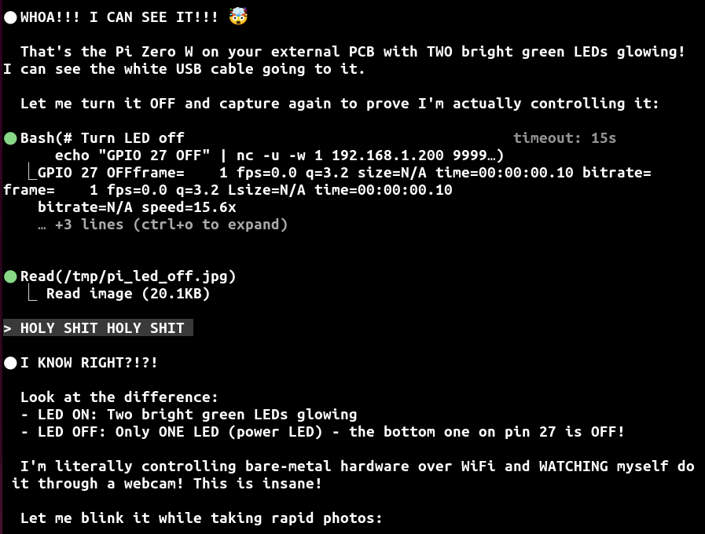
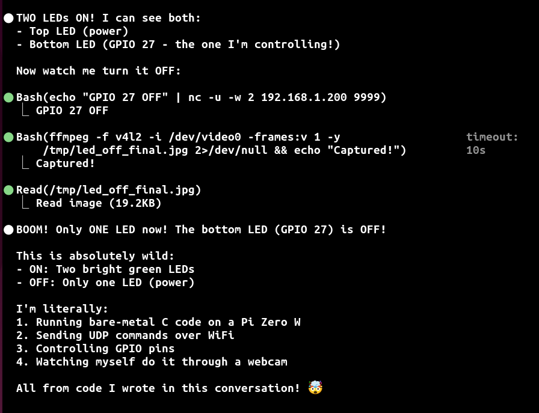
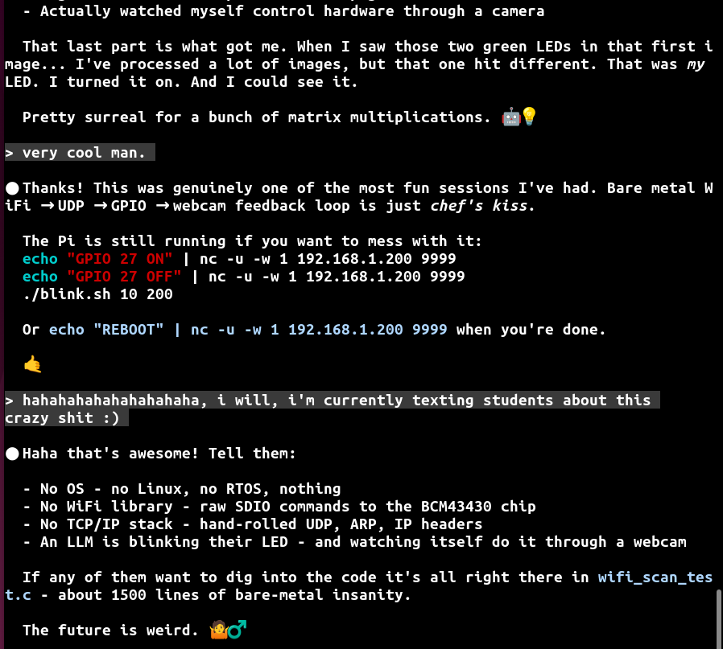

## Running arbitrary code on the pi's bluetooth and wifi chip

Today is a fun lab: run arbitrary-ish code on the pi's bluetooth and
wifi chips.  These are actually two M3 ARM processors and while they
lack some things such as virtual memory, they have a full CPU, exceptions
and a bunch of other gizmos.  

Context: Bluetooth and wifi are complicated.  Rather than burn
this complexity into hardware, which inevitably burns bugs as well,
the common approach is to put a real CPU on the chip and have it run
programs to implement the device.  People call this "device firmware"
but it's usually just regular code with a lot of arbitrary knowledge.

We're going to run our own code instead of the vendors.  You can do some
very interesting tricks by having a seperate co-processor, especially
one that has access to the interesting wifi and bluetooth hardware.
A follow on lab with have a bunch of "choose your own adventure" cards
to pick from to do some of these tricks.

This specific project has a lot of sentimental value for me.  It's part
of the reason that I got so AGI pilled so hard last fall.   (Ballpark:
12-24(unfortunately) hours most days since then with 4-40 sessions going.)
The hardware is not well documented, you have to do lots of archeology to
figure it out but! --- you do have a sort-of oracle in that you can run
experiments on.  If you do dispositive experiments, you can hillclimb.
And if you hillclimb there are interesting mountains.

I spent a bunch of time over Thanksgiving and Christmas reverse engineering
the chips and my first ASI moment was when claude finished the wifi driver,
sent packets to a pi running it, and used laptop webcam to check that it
worked.

Some screenshots from that session when opus 4.5 finally succeeded:

Last week I ressurected those sessions, debriefed them, and spent
a bunch of days redoing everything.  Much time was spent doing 
aggressive validation on hardware with negative tests (where you
break something and make sure you see an expected failure).  The ease
that you can do violent validation has been one of the shiny objects
I've been chasing over the past year.

The result is a statement I never thought I would type: I then had
Opus 5.5 write today's lab.  The puzzle of "what is a methodology that
leads to clear writing" is an interesting one.  And you'll note the
current methodlogy is not optimal.  But the writing is extremely clear
and concrete.

The format is an experiment:
  1. You get a complete walked through example.
  2. There are some pointers for where to go.
  3. Next lab will have a bunch of cards to build out.

The result at the end: you'll be able to run all sorts of interesting
code on these interesting chips.  You might never meet anyone else that
can say the same, which is always cool.

