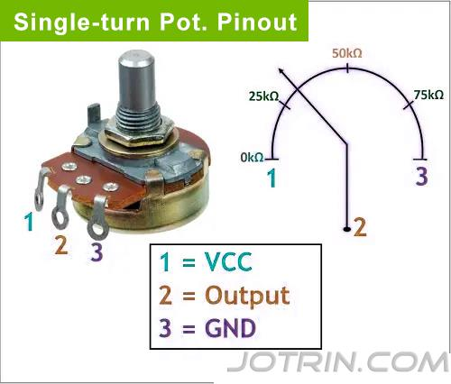
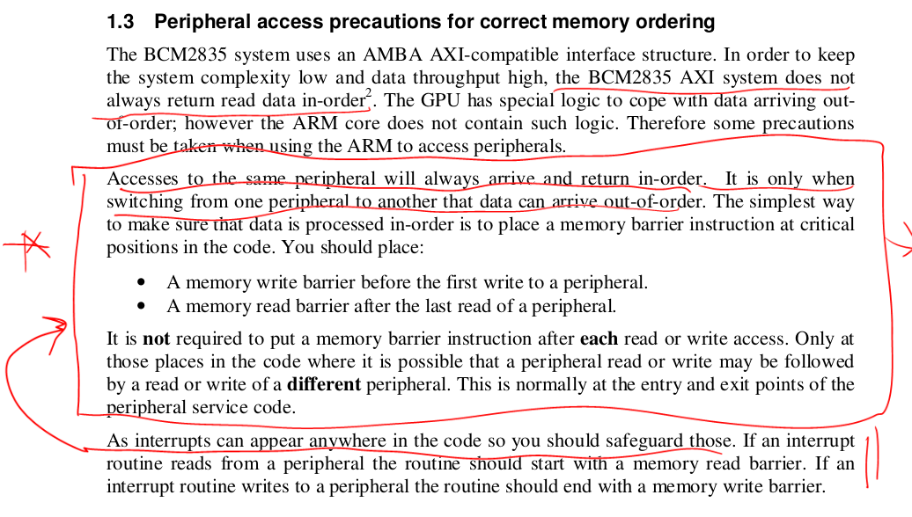

## Zero-component digital adc puzzle lab.

Since I assume everyone is either tired from doing their midterm project
or still doing it before today's presentations, today's lab is a quick
but startling side-quest lab on stuff I've been playing with over the
past years.  It started from last years 340lx, where the results were
unsettling enough that I was mass texting screenshots to more people
than are in the class :)  Hopefully is interesting.

(Insert examples here.)

Use the tricks discussd to:
  1. Make your simple logic analyzer work without a jumper.
  2. Check that your pullup, pulldown, float works.   Pullup: mesure
     cycles to rise from 0 to 1.  Pulldown: same from 1 to 0.  Float:
     same, but will be much much longer.
  3. Make a simple digital ADC for a rotary encoder.  (Measure the
     cycles to go from 1 to 0: that is the resistance.  Will vary
     in units of 50 cycles or so.)

Possible:
  - Light sensor using LED.
  - Build virtual jumpers with DMA.
  - Make a virtual device that drives hardware devices.

I am currently pushing some stuff (wiring for pot and LED).  With that
said, the goal is: couple tiny code examples, some interesting puzzles.
This was what I loved about Max's DMA hack --- just say the two mechanisms
and that it's enough for Turing complete.  No walls of prose or "where
is this routine?"  --- just clean puzzle.  The best kind of LX lab.

-------------------------------------------------------------------
### A zero-component ADC to measure a potentiometer



Potentiometers  take in voltage and attenuate it proportionally to
how much you turn their nob.  If you connect a pot to a digital pin on
the pi and read it directly you will (at best) get 0 or 1 depending on
the position.  (In a typical case: You may well get only 0 or only 1
or smoke.)

I think there are several ways to do it.  One simple recipe:
  1. 3v on the vcc pin.
  2. GPIO on the middle (SENSE) pin.
  3. Rising algorithm:
     1. Set GPIO to floating at the start.
     2. Drive low: Set GPIO to output, Write 0.
     3. Measure how long it takes to go from 0 to 1: flip to input,
        count cycles until 1 (maybe have a timeout).


Calibration:
  1. My max reading using pin 20 was around 1091 cycles.
  2. My min was 0.
  3. If you plug more floating pins in with jumpers the maximum
     should jump.  Same for longer jumpers.

Two games:
  1. Be as precise as possible in your reads.   A raw inlined read
     from the GPIO level register is about 50 cycles.  If you can
     read LEVEL faster (e.g., overclock) you get more accurate.
     If you detect the transition more accurately (e.g.,
     interrupts or dithering) you get a finer resolution.
     More readings, more accurate readings = more bits of precision.
  2. Stretch out how long discharge takes: the longer this is, the
     more readings you get (and more bits).  The easiest (as above):
     add more floating pins (the capacitance is additive).   You can
     also change the shape of the wire.  You can also use longer wires.
     You can probably try different pins --- measure their floating
     discharge and use the ones that take the longest.

Many many tricks for these.   Dithering (from EE) where you average
samples and, ideally, add some some random jitter is a good algorithmic
way.

-------------------------------------------------------------------
## Discussion: memory barriers on bcm2835 are a lie.

This is a bit of a side discussion on one of the implications.  You
don't need it for this lab.  Perhaps interesting though.

<p float="center">
    
</p>


Recall the memory ordering rules from the bcm2835 document:

  1. A memory write barrier before the first write to a peripheral
  2. A memory read barrier after the last read of a peripheral.
  3. In an interrupt handler: since it can occur anywhere, start
     with a memory read barrier and end with a memory write barrier.
  4. Note, however, as they state: "it is not required to put a memory
     barrier instruction after each read or write access [to the same
     device]"

Where a memory barrier can either be:
  - DMB, which (roughly) ensures memory operations before the DMB have 
    been issued and memory operations after the DMB have not.   So for:

        str r0, [A]
        dmb
        str r1, [B]

    We are guaranteed that the store to A has been *initiated* before the
    store to B.  (Note: this does not guarantee they are complete and
    written all the way to main memory.)

    For the broadcom: reads and writes to the same location

  - DSB, which ensures memory operations and their effects *complete*
    before completing.  If you recall from the crazy memory coherence
    lab we did in 140e, we used DSB's when we wanted to make sure that
    hardware changes --- such as flushing a TLB, modifying the page table,
    flushing the data cache --- completed fully (not just got initiated)
    before continuing. Completion is important for expensive operations
    (e.g., cache flushes) where the hardware doesn't necessarily block
    until they are done.

     So for:
```
        <dcache_flush>
        dsb
        str r1, [B]
```
    We are guaranteed that the cache flush has completed before B.

Seems fairly simple, and our heuristic has always been: 

  - Just put a memory barrier when switching from one peripheral to 
    the next.  For example, when using GPIO and switching to SPI.

It turns out this is very much not sufficient!   
  - The distal problem: Just  because you have *issued* a device write,
    it does not mean that write has *completed* when you do the next
    device access.

To reword: Doing a store to a device register does not mean that the
potentially very costly action the store triggers has finished by the
time you do the next load or store to the same device.

If this doesn't make sense: recall that our stores and loads to devices
are a lie --- we aren't actually storing or loading memory.  It's more
accurate to view it that we are doing a remote procedure call using a
network packet across a funny network (a memory bus).  And, of course,
these procedure calls can take a long time.

The high bit on the examples: After many years of 140e/240lx/340lx I
didn't think any of them were problems, and yet they are.

-------------------------------------------------------------------
### 1. Writing GPIO output then reading GPIO input: not sequentially consistent.

Given:
  - `out_pin` configured as output, `in_pin` configured as input;
  - `out_pin` connected to  `in_pin` using a jumper

If you run the following code:

```c
        gpio_set_on_raw(out_pin);
        if(!gpio_read_raw(in_pin))
            nerr_set++;  // Should be high but read low!

        // Set low
        gpio_set_off_raw(out_pin);
        if(gpio_read_raw(in_pin))
            nerr_clr++; // Should be low but read high!
```

You will get errors.   

This example came after I spent a bunch of time messing with LLM prompts
sepetember 2025 to give examples of how missing memory barriers gave
errors.  The code was simple and so against what we've believed that my
immediate reaction was "There is no way that this is a bug.  I've been
wasting the past week.  This is such an obviously stupid hallucination."

But, when I ran it, it was a bug.

Crazy.

My test driver would call the test routine twice, two times with icache
off, two with icache on:
```
no cache: N=1000, set errors=0, clear errors=1000
no cache: N=1000, set errors=1, clear errors=1000
cache: N=1000, set errors=241, clear errors=511
cache: N=1000, set errors=998, clear errors=533
```

As expected, with the icache one we can run faster so are more likely
to see the old stale value.

Note:
  - you'll have to use inlined GPIO routines (you have these from lab 1).
  - To make sure you have consistent results: make sure you handle
    code alignment (recall: prefetch buffer fetches 32-bytes of machine
    code, aligned to 32-bytes).
  - Not crucial (I didn't do this) but I believe: as with lab 1,
    since printk is huge, you can reduce conflicts (and get more errors)
    by pushing the printing after all the code runs or by prefetching
    the instructions.

-------------------------------------------------------------------
### 2. Adding memory barriers is *faster* than no memory barriers.

Use the same setup as above.  Measure the cost of the following 
three code snippets:

  1.  No barrier.

```c
        gpio_set_on_raw(out_pin);
        while (!gpio_read_raw(in_pin));
```

  2. DMB

```c
        gpio_set_on_raw(out_pin);
        dmb_raw();
        while (!gpio_read_raw(in_pin));
```

  3. DSB

```c
        gpio_set_on_raw(out_pin);
        dsb_raw();
        while (!gpio_read_raw(in_pin));
```


How much faster are 2 and 3 compared to no barriers?  For my code:
```
COMPARISON:
  No barrier: 130 us (baseline)
  DMB:        79 us (39.230770% improvement)
  DSB:        79 us (39.230770% improvement)
```
I never would have thought *adding* barriers would speed up code. 
  - NOTE: Might be part of the reason that lab 1 had some weird speedups.

The current belief is that they force the values to be written out rather
than sitting in the arm1176's write buffer.  The sooner they are written
out, the sooner they change the GPIO pad and thus the read back value.

Note, as before to maximize the error:
  1. Make sure all the calls are inlined and what is being
     measured always the same good alignment.
  2. Enable the i-cache.
  3. For this code I did do the change suggested in part 1: put the printing
     after all my measurements and used instruction prefetching:

```c
#include "asm-helpers.h"
cp_asm_set(prefetch_icache_mva, p15, 0, c7, c13, 1)

static void prefetch_inst(void *start, void *end) {
    assert(start<=end);
    uint32_t s = (uint32_t)start & ~0b11111;
    uint32_t e = (uint32_t)end & ~0b11111;
    for(; s < e; s += 32)
        prefetch_icache_mva_set(s);
    prefetch_icache_mva_set(s);
}
```


-------------------------------------------------------------------
### 3. Device configuration is not guaranteed to complete before use.


***NOTE***:
  - At least for gpio where you change the ouput, I can't figure out a way 
    to make the below work (see discussion at the end) 

Until today, our pattern for device configuration and use has been:

  1. Configure devices (GPIO, UART, SPI etc) using loads and stores to
     the memory associated with that device.

  2. Then use the device by doing loads and stores to the same
     device memory as (1),  though generally to different device memory
     offsets.

Because (1) and (2) are to the same device, we have never used
a barrier --- and in fact have told people in 140e to delete
barriers as unnecessary because of the 
BCM2835 document's statement (mentioned above):

  - "it is not required to put a memory
    barrier instruction after each read or write access [to the same
    device]"

As you are probably starting to realize from the first two examples,
our belief was wrong!  Just because the following two statements are
true:
  1. We have *initiated* the loads/stores to configure a device.
  2. *And* we are *guaranteed* the subsequent load/stores to use it
     initiated after (1).

There is in fact: *no guarantee* that (1) is *complete* before (2).

Keep the hardware as before.  Simple code example:
  1. First setup state:
     1. Setup GPIO `out_pin` as output, write a 0: make sure when you 
        read from it using `in_pin` you get a 0.  This is no speed critical.
     2. Now set GPIO `out_pin` as input: do a dsb so you are sure it is input.
        This is no speed critical.
  2. Then do the following punchline:  
     1. In two instructions, (1) change to `out_pin` back to output and 
        (2) write a 1.  Do a DSB so you know this step has completed.
     2. Read the input pin `in_pin`. Count as an error if it is still the initial
        state 0.

How many errors do you get?


#### I couldn't get this bug to show up for GPIO.

The main challenge here is to do the 
the following in two instructions:
  1. Change to `out_pin` back to output
  2. Write a 1 to it.

If you disassemble your code it's probably initially huge.

To have better control and easier debugging, I put both steps
in their own routine so I could easily inspect:

```
// set to output, write a 1.
// <bank> = the GPIO function bank to write to. 
// <loop> = the loopback config
// <set> = the GPIO set register to write to.
void change_conf(uint32_t bank, uint32_t loop, uint32_t set) {
    asm_align(5);
    PUT32_raw(bank, loop);          // set to loopback.
    PUT32_raw(set, 1<<out_pin);     // write 1.
}
```

In order to defeat gcc's bad GPIO constant handling (we saw this in
lab 1) I precomputed the bank to write to, and the two values:
  - `loop`: `in_pin` is input, `out_pin` is output, so loopback works.
  - `broke`: `in_pin` is input, and `out_pin` is also input so loopback
    does not work.  

```
    // get the bank needed for out_pin (from your GPIO code.)
    uint32_t bank = GPIO_BASE + (out_pin/10)*4;

    // get the working loopback config
    //  in = input, out = output
    uint32_t loop = GET32_raw(bank);

    // change out_pin to be an input and get that
    // config
    gpio_set_input(out_pin);
    uint32_t broke = GET32_raw(bank);
```

After doing a bunch of sanity checking code to verify `loop` 
restores the loopback and `broke` breaks it, the config-use check
becomes:

```
    assert(GET32(bank) == broke);
    assert(gpio_read(in_pin) == 0);
    // quickly change back to loopback and set out_pin to 1.
    change_conf(bank, loop, gpio_set0);
    dev_barrier();
    // if in_pin is still 0 we know config and set were not ordered.
    if(gpio_read(in_pin) == 0) {
        output("iter=%d: err!\n");
        err += 1;
    }
```
Unfortunately I never got an error.  Weird.  I do expect that the
given issue does come up with more complicated devices (UART, SPI)
but have not verified.  This is a great extension project!

-------------------------------------------------------------------
### 4. Do some other error example

Even better if you can do on another board.  I'm very very very curious!

